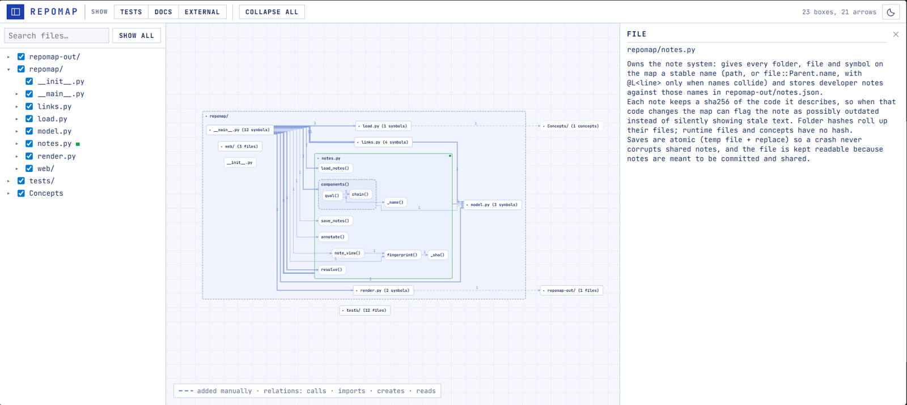

# repomap

> **See your whole codebase on one page — and keep notes that tell you when they go stale.**




## Why repomap

- 📦 **The whole repo at a glance** — folders are frames, files are boxes, real `calls` / `imports` arrows carry a count.
- 📝 **Notes that know when they're stale** — pin a note to a folder, file or function; when the code changes, the map flags it *"may be outdated"*.
- 🔗 **Fill the gaps** — add arrows, runtime files and concepts graphify can't see. They survive `graphify update`.
- 🤖 **Claude Code skill** — say *"save this note"* and Claude writes it to the map.
- 📴 **One offline HTML file** — no server, no dependencies, standard library only.

## Quick start

```
uv tool install graphifyy
uv tool install git+https://github.com/DongNQ247/repomap

graphify update .     # build the graph
repomap .             # draw the map → repomap-out/map.html
```

Open the printed `file://` link in your browser.

> **repomap vs graphify:** [graphify](https://pypi.org/project/graphifyy/) parses your code into `graph.json`.
> repomap turns that graph into an interactive map and adds notes and manual links on top.

## Features

### 🗺️ Explore the map

- Click a folder to expand it; arrows into collapsed folders merge and sum their counts.
- Click a file to see its functions and classes; `calls` arrows attach to the function itself.
- Click an arrow for a breakdown by relation and symbol pairs with `file:line`.
- Scroll to zoom, drag to pan.

### 📝 Notes

```
repomap note add app/db/store.py::save "Writes atomically via temp file + rename"
```

Each note stores a sha256 fingerprint of its code. Change the code and the box turns **yellow** —
check the note, then `note add` new text or `note ok` to confirm it.

### 🔗 Manual links

```
repomap link add app/cli.py creates repomap-out/map.html
```

graphify arrows are solid, manual ones dashed. Saved in `repomap-out/links.json`, never in `graph.json`.

### 🌲 Tree panel

Browse the folder tree, search by name, uncheck anything to hide it (and its arrows) from the map,
click a name to jump to it.

### 🤖 Claude Code skill

```
repomap skill install
```

Claude learns to save notes only when you ask, name components correctly and handle outdated notes.

---

## Reference

<details>
<summary><b>Install options</b></summary>

```
uv tool install git+https://github.com/DongNQ247/repomap@v1.1.5   # pinned version
uv tool upgrade repomap
uv tool uninstall repomap
```

Requirements: Python 3.10+ and [graphify](https://pypi.org/project/graphifyy/).
</details>

<details>
<summary><b>Command line</b></summary>

```
repomap .                  # reads ./graphify-out/graph.json, writes repomap-out/map.html (same as plain `repomap`)
repomap PATH               # PATH is a graph.json, or a folder containing graphify-out/graph.json
repomap -o out/map.html    # write somewhere else
repomap -q                 # print only the absolute path of the written file
repomap --version
```

- Output goes to `repomap-out/` in the project root (the folder that holds `graphify-out/`). Changed in 1.1.0: it used to be `graphify-out/map.html`.
- An existing `map.html` is overwritten. The browser is not opened; the command prints a `file://` link.
- Exit code 1: `graph.json` missing (repomap prints how to build it), invalid JSON, not a graphify graph, or unwritable output. Exit code 2: bad arguments.
</details>

<details>
<summary><b>Notes</b></summary>

```
repomap note add <name> "<text>"   # save, or replace the existing note
repomap note delete <name>
repomap note ok <name>             # the code changed but the note is still right
```

Notes are saved in `repomap-out/notes.json` and shown after the next `repomap .` run.

**Names** are relative to the project root and work from any subfolder:

- folder: `app/db`
- file: `app/db/store.py`
- symbol: `app/db/store.py::save`, method: `app/models.py::User.display`
- two symbols with the same name in one file: add the line, `app/dup.py::helper@L40` (repomap lists the valid names)

Notes whose component no longer exists (renamed or deleted) are kept and listed by `repomap` so you can `note delete` them.

Suggested: commit `repomap-out/notes.json`, and add `repomap-out/map.html` to `.gitignore`.
</details>

<details>
<summary><b>Manual links</b></summary>

```
repomap link node <path>             # runtime file, e.g. repomap-out/map.html
repomap link node <name> --concept   # concept outside the code, e.g. SSD
repomap link add <src> <rel> <tgt>   # rel: calls | imports | creates | reads
repomap link delete <src> <rel> <tgt>
repomap link delete <name>           # remove a runtime node or concept (delete its arrows first)
```

Names follow the note rules. On the map, manual arrows are dashed and manual boxes dotted; concepts sit in a
"Concepts" frame; an arrow is dashed only when every link merged into it was added by hand.
`repomap` lists links whose ends no longer exist and manual nodes graphify now finds, so you can
`link delete` them. Suggested: commit `repomap-out/links.json`.
</details>

<details>
<summary><b>Map controls</b></summary>

- All folders, files and classes start collapsed. Files with no symbols (e.g. an empty `__init__.py`) do not open.
- Click a folder, file or symbol to show its details and note in the right panel. Click a symbol again, the `x` button or the background to close it. Boxes with a note are outlined green, or yellow when the note may be outdated.
- Imports and module-level calls stay on the file frame; `calls` merge up to the nearest visible class/file when collapsed. File-level arrow counts are unchanged.
- **Show > Tests**: show arrows that start from test files (test boxes are always shown).
- **Show > Docs**: show `.md`, `.json`, `.yml`, `.toml`… files.
- **Show > External**: show a frame of symbols outside the repo (nodes without `source_file`), by symbol name.
- **Collapse all**: back to the initial state.
- If expanding would show more than 400 boxes + arrows, you are asked to confirm first.
</details>

<details>
<summary><b>Tree panel</b></summary>

- **Tree** in the top bar opens/closes it (closed by default on narrow screens). Expanding in the tree does not change the map.
- Unchecking hides an item and every arrow into or out of it; a folder shows a partial state when only some contents are hidden. **Show all** brings everything back; hidden state is not kept on reload.
- **Search files…** filters by name (case-insensitive substring) and shows the path to each match.
- Click a name to open its parent folders on the map, center it and highlight it.
- Symbols are listed too (classes bold, functions italic); hover shows `file:line`.
- The tree only lists what the filter buttons allow. Counts and the 400-item check exclude hidden items.
</details>

<details>
<summary><b>Claude Code skill</b></summary>

`repomap skill install` copies SKILL.md to `~/.claude/skills/repomap/SKILL.md` (overwrites).
Run it again after `uv tool upgrade repomap` to update the skill.
</details>

## Development

```
python3 -m unittest discover tests -v
node --test tests/*.test.mjs
```

## License

MIT. Third-party: the bundled ELK layout engine (elkjs 0.9.3) is EPL-2.0; see `repomap/web/vendor/LICENSE-elk.txt`.
